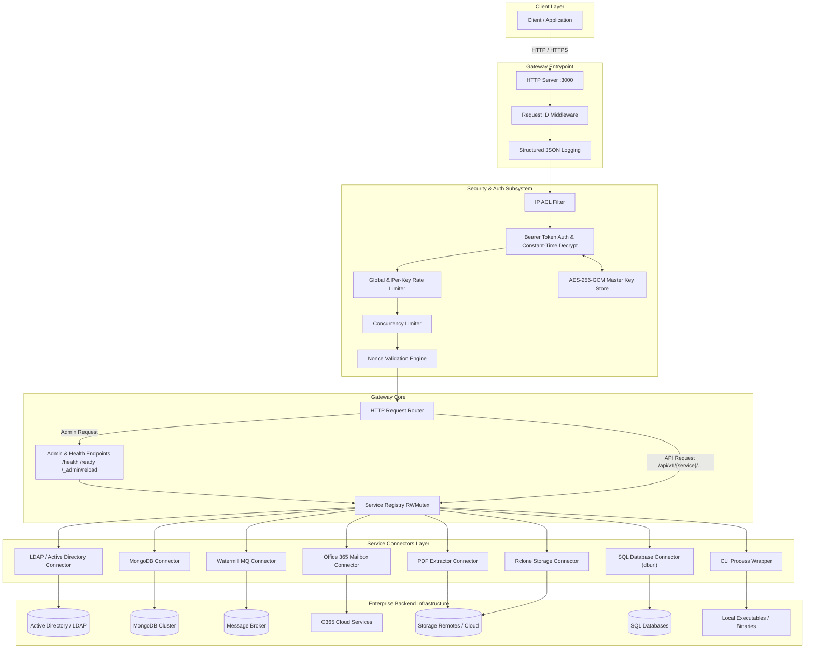
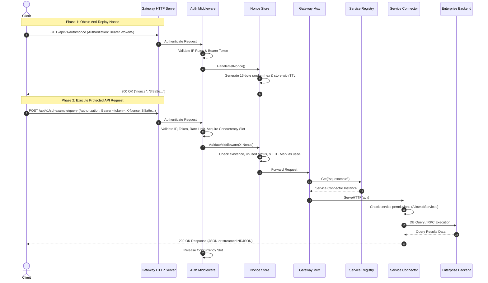

# Service Gateway Architecture Specification

## Section 1: Architecture and Design Choices

### 1.1 Architecture Overview
The Service Gateway is a high-performance, secure, extensible API gateway written in Go (`1.25.0`). It acts as a reverse proxy, security boundary, and adapter layer between enterprise clients and internal backend infrastructure (such as LDAP/Active Directory, MongoDB, SQL databases, Message Queues, Office 365 Mailboxes, Rclone remotes, PDF extraction engines, and CLI wrappers).

### 1.2 Key Design Choices
- **Dynamic Modular Plugin Architecture**: Services are decoupled via the [Service](internal/services/interface.go#L8) interface. Each backend integration registers a factory with [RegisterType](internal/services/types.go#L16). Services are dynamically loaded at runtime from JSON configurations in the services directory via [Registry](internal/services/registry.go#L12).
- **Zero-Trust & Multi-Layer Security**:
  - **Envelope Encryption**: Secrets in service configurations are encrypted using AES-256-GCM with a master key (`ENC[...]` envelope syntax). Handled by [crypto](internal/crypto/crypto.go#L1).
  - **Anti-Replay Nonce Mechanism**: Requests to protected `/api/v1/` routes require a single-use time-bound nonce issued via `/api/v1/auth/nonce` managed by [NonceStore](internal/auth/nonce.go#L12).
  - **Constant-Time Auth**: Bearer tokens are validated using [subtle.ConstantTimeCompare](internal/auth/middleware.go#L167) to eliminate timing side-channel attacks.
  - **Memory & Process Protections**: Supports process memory locking via `mlockall` on Unix via [unixPlatform](internal/platform/platform_unix.go#L78) to prevent swapping secrets to disk. Strict file permission validation (`0600`/`0400` on Unix, restricted paths and ACLs on Windows).
  - **Rate Limiting & Concurrency Throttling**: Global and per-key token-bucket rate limiters ([RateLimiter](internal/auth/ratelimit.go#L1)) plus per-key max concurrency limiters ([concurrencyLimiter](internal/auth/middleware.go#L24)).
  - **IP ACL Filtering**: Configurable CIDR-based IP allow/deny lists.
- **Platform Abstraction**: OS-dependent operations (signals, memory locking, permissions, resource limits) are encapsulated behind the [Platform](internal/platform/platform.go#L5) interface with specialized implementations for [unixPlatform](internal/platform/platform_unix.go#L16) and [windowsPlatform](internal/platform/platform_windows.go#L10).
- **Hot Reloading & Operational Observability**: Configuration hot-reloading without downtime via `POST /_admin/reload` or `SIGHUP` signal. Correlation tracking via request ID propagation (`X-Request-ID`). Comprehensive health and readiness probes (`/health`, `/ready`).

### 1.3 Assumptions
1. **Master Key Provisioning**: The master encryption key is pre-provisioned via environment variable or a secure file on disk with restricted read permissions (`0600`/`0400`).
2. **Client Nonce Workflow**: Clients calling protected API endpoints fetch a single-use nonce via `GET /api/v1/auth/nonce` and pass it in the `X-Nonce` header.
3. **Configuration Hierarchy**: Each service instance is configured via a `config.json` file located in its dedicated directory under `services/`.
4. **Network Access**: The gateway host has reachable network connectivity and requisite network credentials to downstream enterprise backends.

### 1.4 Edge Cases
- **Master Key Loss or Corruption**: Gateway fails at boot during [InitMasterKey](internal/crypto/crypto.go#L38) with explicit security errors (e.g. [ErrInsecurePermissions](internal/crypto/crypto.go#L23), [ErrInsecureLocation](internal/crypto/crypto.go#L22)).
- **Insecure Key File Permissions**: Key validation rejects world-readable key files on Unix or unsafe temp paths on Windows.
- **Nonce Replay / Expiration**: Nonces are atomically invalidated after first use or deleted after TTL expiry by a background ticker in [NonceStore.cleanup](internal/auth/nonce.go#L78).
- **Service Reload Isolation**: Invalid JSON configuration during hot reloads logs an error and skips loading the broken service without disrupting existing active services.
- **Backend Service Degradation**: The `/ready` endpoint executes per-service [HealthCheck](internal/services/interface.go#L12) calls and returns HTTP 503 `degraded` when any backend fails.
- **Rate / Concurrency Exhaustion**: Requests exceeding rate limits or concurrency quotas return `HTTP 429 Too Many Requests` to protect downstream systems.

### 1.5 Performance and Efficiency
- **Non-blocking Concurrent Reads**: Read paths (retrieving service handlers, looking up key secrets) use `sync.RWMutex` read locks for lockless parallel request handling.
- **Chunked Data Streaming**: Large payload responses (MongoDB queries, SQL selects, LDAP searches, file downloads) support chunked NDJSON streaming via [BaseService.StreamJSON](internal/services/base.go#L43) to minimize memory footprint.
- **Connection Reuse**: Service connectors maintain long-lived connection pools (`mongo.Client`, `sql.DB`).
- **Low-Overhead Logging**: Context-correlated structured logging using `log/slog`.

### 1.6 Architectural Boundaries and Scope
- **Local Sidecar Binding**: The gateway is intentionally designed to bind exclusively to `127.0.0.1` (loopback) as a local integration sidecar daemon on each integration host.
- **Single-Node In-Memory Design**: All state management—including anti-replay nonces ([NonceStore](internal/auth/nonce.go#L12)), token-bucket rate limiters ([RateLimiter](internal/auth/ratelimit.go#L1)), max concurrency semaphores, and database connection pools—operates in-memory per node. Distributed multi-node clustering behind external load balancers is explicitly out of scope for this sidecar architecture.

### 1.7 System Architecture Diagram

---

## Section 2: Data Flow and Control Logic

### 2.1 Operational Flow

#### Startup & Initialization Sequence
1. **CLI Flag & Config Resolution**: [main](cmd/gateway/main.go#L37) in [main.go](cmd/gateway/main.go) parses command-line flags (`-config`, `-version`, `-key-gen`). Loads configuration file via [config.Load](internal/config/config.go#L44).
2. **Logger Initialization**: Instantiates structured JSON logger via [logging.New](internal/logging/logger.go#L15) and sets default via `slog.SetDefault`.
3. **Master Key Setup**: Initializes AES-256 master key via [crypto.InitMasterKey](internal/crypto/crypto.go#L38) from environment variable or file.
4. **Platform Security Controls**: Queries operating system platform via [platform.Current](internal/platform/platform.go#L15). If enabled in config, invokes [LockMemory](internal/platform/platform_unix.go#L78) to lock memory pages.
5. **Service Discovery & Instantiation**: Creates service [Registry](internal/services/registry.go#L12) and executes [LoadServices](internal/services/registry.go#L26). Reads subdirectories under `services/`, parses `config.json`, decrypts encrypted secrets via [Decrypt](internal/crypto/crypto.go#L123), and invokes factory constructors via [CreateService](internal/services/types.go#L22).
6. **Auth & Nonce Subsystem**: Instantiates [Middleware](internal/auth/middleware.go#L52) and [NonceStore](internal/auth/nonce.go#L12) (spawning background cleanup ticker).
7. **Gateway Server Startup**: Assembles [Gateway](internal/gateway/gateway.go#L17) HTTP mux via [Handler](internal/gateway/gateway.go#L52), attaches middleware chain, and launches `http.Server`.
8. **Signal Listener & Graceful Shutdown**: Listens for `SIGHUP` for hot reloads via [SetupReloadSignal](internal/platform/platform_unix.go#L20) and `SIGINT`/`SIGTERM` for graceful shutdown, draining open connections and calling [CloseAll](internal/services/registry.go#L102).

#### Request Processing Sequence
1. **Request ID Injection**: [requestIDMiddleware](internal/gateway/gateway.go#L185) assigns or forwards `X-Request-ID` in request context and response header.
2. **Access Control & Rate Checks**: [Authenticate](internal/auth/middleware.go#L100) checks IP ACLs, extracts `Bearer <token>`, performs constant-time secret comparison against decrypted keys, checks rate limit buckets, and acquires a concurrency slot.
3. **Nonce Validation**: For API endpoints, [ValidateMiddleware](internal/auth/nonce.go#L111) checks `X-Nonce` header, ensuring it exists, is un-used, and has not exceeded TTL. Marks nonce as used atomically.
4. **Service Dispatch**: [handleAPI](internal/gateway/gateway.go#L143) extracts `{serviceName}` from URL `/api/v1/{serviceName}/...`, validates API key permissions via [isServiceAllowed](internal/gateway/gateway.go#L173), rewrites request path, and delegates to `svc.ServeHTTP(w, r)`.
5. **Backend Execution & Response**: Service connector executes backend action and writes JSON or streams NDJSON back to client.

### 2.2 Code Relations & Modules
- **`cmd/gateway`**: Application entrypoint ([main.go](cmd/gateway/main.go)). Flags, lifecycle management, signal listening.
- **`internal/config`**: Config parsing and models ([config.go](internal/config/config.go)).
- **`internal/crypto`**: Master key resolution, AES-256-GCM envelope encryption/decryption, permission validations ([crypto.go](internal/crypto/crypto.go)).
- **`internal/auth`**:
  - Authentication middleware & token verification ([middleware.go](internal/auth/middleware.go)).
  - Nonce store & cleanup loop ([nonce.go](internal/auth/nonce.go)).
  - Token-bucket rate limiter ([ratelimit.go](internal/auth/ratelimit.go)).
  - mTLS utilities ([mtls.go](internal/auth/mtls.go)).
- **`internal/gateway`**: HTTP router, administration handlers, request ID middleware, request logging ([gateway.go](internal/gateway/gateway.go)).
- **`internal/logging`**: Context-aware structured logger ([logger.go](internal/logging/logger.go)).
- **`internal/platform`**: Cross-platform OS abstraction interface ([platform.go](internal/platform/platform.go), [platform_unix.go](internal/platform/platform_unix.go), [platform_windows.go](internal/platform/platform_windows.go)).
- **`internal/services`**: Service abstractions, base implementation, service factory registry, connector drivers:
  - Interfaces and Registry: [interface.go](internal/services/interface.go), [base.go](internal/services/base.go), [registry.go](internal/services/registry.go), [types.go](internal/services/types.go).
  - Connectors:
    - LDAP: [ldap/handler.go](internal/services/ldap/handler.go)
    - MongoDB: [mongodb/handler.go](internal/services/mongodb/handler.go)
    - MQ: [mq/handler.go](internal/services/mq/handler.go)
    - Office 365 Mailbox: [o365mbx/handler.go](internal/services/o365mbx/handler.go)
    - PDF Extractor: [pdfextractor/handler.go](internal/services/pdfextractor/handler.go)
    - Rclone: [rclone/handler.go](internal/services/rclone/handler.go)
    - SQL Database: [sql/handler.go](internal/services/sql/handler.go)
    - CLI Wrapper: [wrapper/handler.go](internal/services/wrapper/handler.go)

### 2.3 Data Sequence Diagram

---

## Section 3: Dependencies

### 3.1 Core Runtime Environment
- **Go Programming Language**: Version `1.25.0`

### 3.2 Direct Go Library Dependencies
The application relies on direct third-party modules specified in [go.mod](go.mod):

| Dependency Module | Version | Purpose / Utility |
| :--- | :--- | :--- |
| `criticalsys.net/pdf-extractor` | `v0.0.0` (local replace) | Custom module for structured data extraction from PDF documents and invoices |
| `github.com/ThreeDotsLabs/watermill` | `v1.5.2` | Event-driven messaging framework used by the Message Queue (`mq`) connector |
| `github.com/go-ldap/ldap/v3` | `v3.4.14` | LDAP v3 protocol library for Active Directory authentication and search operations |
| `github.com/rclone/rclone` | `v1.74.4` | Cloud and remote storage abstraction library used by the `rclone` connector |
| `github.com/xo/dburl` | `v0.24.2` | Universal SQL database connection URL parser supporting multiple database drivers |
| `go.mongodb.org/mongo-driver` | `v1.17.9` | Official MongoDB Go driver for MongoDB database connections and queries |
| `golang.org/x/sys` | `v0.47.0` | Low-level operating system interface for Unix memory locking, file permissions, and system calls |

### 3.3 Indirect Dependency Highlights
- `github.com/prometheus/client_golang` (`v1.24.0`): Prometheus metrics exposition.
- `github.com/shirou/gopsutil/v4` (`v4.26.6`): System performance and resource utilization metrics.
- `golang.org/x/crypto` (`v0.54.0`): Cryptographic algorithms and network security routines.
- `gopkg.in/natefinch/lumberjack.v2` (`v2.2.1`): Rolling log file management.

### 3.4 Platform Utilities and Administrative Tools
- **Windows System Utility (`icacls`)**: Invoked by [SecureFilePermissions](internal/platform/platform_windows.go#L18) on Windows to enforce strict file ACLs (restricting key read access to the current running user).
- **Unix System Calls**: `mlockall`, `setrlimit`, `setuid`/`setgid`, `chmod` invoked via `golang.org/x/sys/unix`.

### 3.5 Operational Configuration Files
- **[config.json](config.json)**: Main gateway configuration specifying server port, timeouts, authentication keys, IP rules, rate limits, and services directory.
- **`master.key`**: Encryption key file containing the 256-bit hex master key used for decrypting secrets.
- **`services/{service-name}/config.json`**: Individual configuration file for each dynamic service connector.
